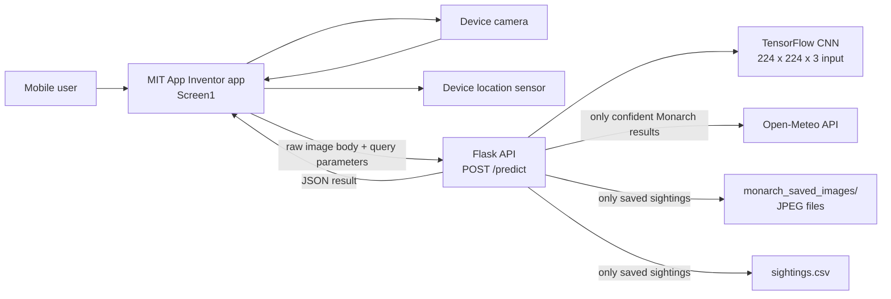
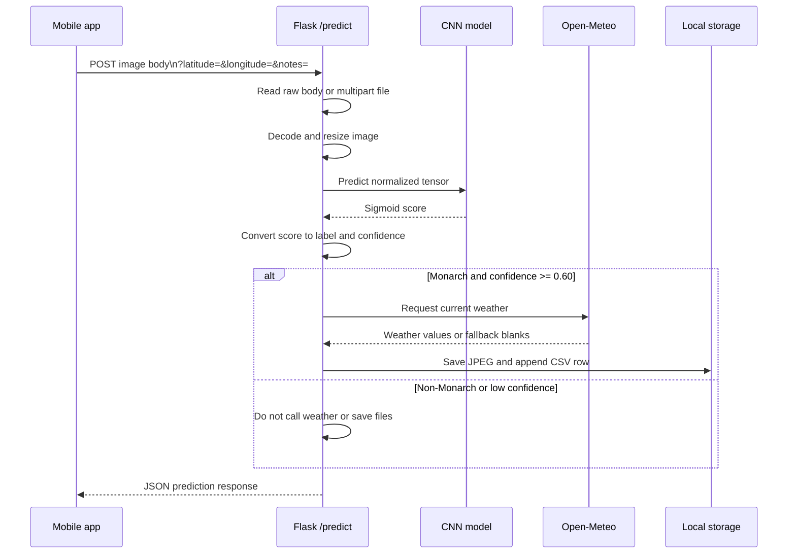

# Monarch Detector Architecture

## 1. System Overview

Monarch Detector is a two-part application:

- **Mobile client:** An MIT App Inventor application packaged as `app_inventor/Monarch_detector.aia`.
- **Inference service:** A Flask application in `flask_backend/app.py` that accepts an image, classifies it with a TensorFlow CNN, optionally enriches a qualifying sighting with weather data, and stores the sighting locally.

The mobile client captures the image and location. The Flask service owns image preprocessing, prediction, confidence decisions, weather retrieval, and persistence. The backend reduces valid coordinates to two decimal places immediately after validation, so neighborhood-level coordinates are the only coordinates used after the request boundary.

## 2. Component Architecture



### Mobile client

The App Inventor screen contains:

- A static "Butterfly of the week" image and identification text.
- An image preview for the captured photo.
- A camera button.
- A location sensor for latitude and longitude.
- A Web component named `Web_Predict` for calling the Flask API.
- A result label for displaying the prediction.

The camera workflow checks whether latitude and longitude are available, captures a picture, displays the preview, configures the Web URL, and posts the image using App Inventor's `PostFile` method. The response is decoded as JSON and used to update the result label.

The current Web component URL is an ngrok tunnel URL embedded in the `.aia` project. This is environment-specific and must be changed when the backend address changes.

### Flask backend

`flask_backend/app.py` is a single-process Flask service with these responsibilities:

1. Build the CNN architecture and load local weights at startup.
2. Accept raw image bodies or multipart file uploads.
3. Validate optional latitude and longitude query parameters.
4. Reduce valid coordinates to two decimal places before using them anywhere else.
5. Decode, convert to RGB, resize to `224 x 224`, and normalize image data to `[0, 1]`.
6. Generate a binary Monarch/Non-Monarch prediction.
7. Save qualifying Monarch sightings and retrieve current weather for approximated coordinates.
8. Return a JSON response to the mobile client.

## 3. Request Lifecycle



## 4. Model and Decision Logic

The service constructs a binary convolutional neural network with:

- Input shape: `224 x 224 x 3`.
- Two convolution and max-pooling stages, using 32 and 64 filters.
- A flattened representation and 64-unit dense layer.
- One sigmoid output unit.

Weights are loaded from `flask_backend/monarch_weights.weights.h5`. The file must exist before the Flask module starts; the service raises `FileNotFoundError` otherwise.

The raw sigmoid output is interpreted as follows:

- `raw_prediction >= 0.5`: label `Monarch`, confidence equals the raw score.
- Otherwise: label `Non-Monarch`, confidence equals `1 - raw_prediction`.

A result is persisted only when the label is `Monarch` and confidence is at least `0.60`.

## 5. API Contract

### `GET /`

Returns a health-style JSON response identifying the prediction route and weather integration.

### `POST /predict`

The image can be supplied in either form:

- As a multipart upload in any request file field.
- As the raw request body, which is the mode used by App Inventor `PostFile`.

Optional query parameters:

| Parameter | Purpose |
| --- | --- |
| `latitude` | Latitude text, validated to `-90..90`, then rounded to two decimal places. |
| `longitude` | Longitude text, validated to `-180..180`, then rounded to two decimal places. |
| `notes` | User notes stored with a saved sighting. |

Successful responses include `label`, `confidence`, `raw_score`, `saved`, `sighting_id`, `image_filename`, location fields, a timestamp, and a `weather` object. Invalid image data returns `400`; oversized requests return `413`; saving failures return `500` after prediction; unexpected failures return `500`.

The upload limit is 50 MB. The request parser is also configured for a 50 MB multipart memory limit and up to 10,000 form parts.

## 6. Persistence Model

Persistence is filesystem-based and local to the Flask process directory:

- `flask_backend/monarch_saved_images/<uuid>.jpg` stores the normalized JPEG for each saved sighting.
- `flask_backend/sightings.csv` stores one row per saved sighting.

The CSV contains the sighting UUID, image filename, prediction, confidence, approximated coordinates, timestamp, notes, and the weather fields returned by Open-Meteo. Missing values are written as blank cells. Weather failure does not prevent a qualifying image from being saved; weather fields remain empty. Exact coordinates are not stored by the application.

There is no database, authentication layer, user account model, background job queue, or object storage integration in the current project.

## 7. External Dependencies and Runtime Requirements

The backend imports Flask, TensorFlow, NumPy, Pillow, Requests, and Werkzeug. A compatible Python environment and these packages must be installed manually because the repository currently contains no dependency manifest.

The backend also requires:

- `monarch_weights.weights.h5` in `flask_backend/`.
- Network access to `api.open-meteo.com` for weather enrichment.
- A reachable server URL configured in the App Inventor Web component.

The development entry point runs Flask on `0.0.0.0:5000` with debug mode disabled and the reloader disabled. The App Inventor project currently targets an ngrok HTTPS tunnel rather than a stable production hostname.

## 8. Repository Layout

```text
.
├── README.md
├── architecture.md
├── app_inventor/
│   └── Monarch_detector.aia       # MIT App Inventor source archive
└── flask_backend/
    └── app.py                     # Flask API, model, weather, storage
```

The model weights and runtime-generated `monarch_saved_images/` and `sightings.csv` are not currently present in the repository listing. They are deployment/runtime artifacts rather than source files.

## 9. Operational Considerations

- The API has no authentication or authorization, so anyone who can reach the endpoint can submit images and consume inference resources.
- The mobile client currently transmits the device coordinates to the API; the backend rounds them immediately and does not persist or return the exact values. For stronger privacy, round coordinates in the App Inventor blocks before constructing the request URL, so exact values never leave the device.
- CSV appends and image writes are local and are not designed for concurrent multi-worker coordination or durable backups.
- The model is loaded during module import, which makes startup dependent on TensorFlow availability and the weights file.
- The mobile client depends on a hard-coded tunnel URL; URL configuration should be externalized for repeatable deployments.
- The service logs request details and prediction information to standard output. Logs should be reviewed before production use if request data may be sensitive.
- Weather retrieval is synchronous and can wait up to 10 seconds, although failures degrade to blank weather data.